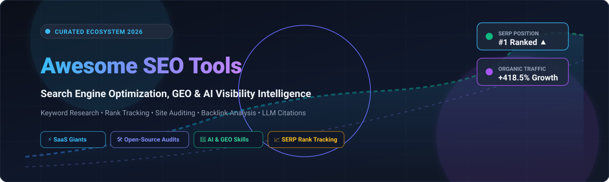

# Awesome Search Engine Optimization (SEO) Tools 🚀

  

  
  
  
  
  
  
  

> 🔍 **A curated list of leading SaaS platforms and open-source GitHub projects for Search Engine Optimization (SEO), Generative Engine Optimization (GEO), technical site auditing, rank tracking, backlink analysis, and keyword intelligence.**

📅 **Last updated:** October 2026

Search Engine Optimization (SEO) tools empower digital marketers, growth engineers, agencies, and site owners to audit technical crawlability, unearth high-intent keyword opportunities, track SERP ranking positions, examine competitor backlink profiles, and monitor visibility across both traditional search engines (Google, Bing) and emerging AI answer engines (ChatGPT Search, Perplexity, Google AI Overviews). 🎯

---

## 📑 Table of Contents

- [📊 Sector Overview & Market Dynamics](#-sector-overview--market-dynamics)
- [🏢 SaaS / Hosted Platforms](#-saas--hosted-platforms)
- [💻 Open-Source GitHub Projects](#-open-source-github-projects)
- [🧠 Key Architectural Considerations & Cost Caveats](#-key-architectural-considerations--cost-caveats)
- [🤝 How to Contribute](#-how-to-contribute)
- [💖 Support](#-support)
- [⭐ Star History](#-star-history)
- [📜 License & Disclaimer](#-license--disclaimer)

---

## 📊 Sector Overview & Market Dynamics

The global Search Engine Optimization (SEO) software market is estimated at **$7.5 billion in 2025–2026**, expanding at a compound annual growth rate (CAGR) of approximately 14–16% as AI-driven search experiences (GEO / AEO) redefine organic discovery. 📈

The sector is **moderately concentrated** at the enterprise and mid-market data layers—where commercial giants like HubSpot, Semrush, and Ahrefs command deep data moats with multi-billion-page backlink and web indexes—yet **highly fragmented** across specialized niche verticals including technical site crawlers, AI content optimizers, local rank trackers, and autonomous agent-based SEO workflows. 🌐

---

## 🏢 SaaS / Hosted Platforms

Leading commercial SaaS platforms ranked by company scale (market capitalization, estimated valuation, or annual revenue):

| Platform 🛠️ | Company Scale (Valuation / Revenue) 💼 | Starting Price (Paid Tier) 🏷️ | Free Tier / Free Trial Limits 🎁 | Key Focus & Capabilities ⚡ |
| :--- | :--- | :--- | :--- | :--- |
| **[HubSpot SEO](https://www.hubspot.com/products/marketing/seo)** | ~$30B Market Cap (NYSE: HUBS) / $2.6B ARR | $15/month/seat (Starter Marketing Hub) | **Free forever plan** with basic CMS/website builder, limited SEO recommendations, and up to 5 website pages | Inbound marketing, topic clusters, on-page optimization, and CRM-connected attribution |
| **[Semrush](https://www.semrush.com/)** | ~$1.8B Market Cap (NYSE: SEMR) / $350M+ ARR | $139.95/month (Pro Tier) | **Free forever account** with 10 search queries/day, 1 project, and 100 crawled pages/month (or 7-day full Pro trial) | All-in-one suite with 25B+ keyword database, competitive analysis, backlink audits, and position tracking |
| **[Ahrefs](https://ahrefs.com/)** | ~$100M+ ARR (Bootstrapped / Private) | $129/month (Lite Tier) | **Ahrefs Webmaster Tools (AWT)** free forever for verified domain owners (5,000 crawl credits/month); no unverified free trial | Gold standard web backlink index, Site Explorer, Content Explorer, and SERP keyword tracking |
| **[BrightEdge](https://www.brightedge.com/)** | ~$100M ARR (~$500M Valuation) | ~$750/month (Enterprise contract starting tier) | **No free tier**; interactive demo available upon qualification with custom sandbox trial (typically 14 days) | Enterprise organic search platform with Data Cube intelligence, Generative Parser, and automated recommendations |
| **[Conductor](https://www.conductor.com/)** | ~$70M ARR (~$500M Valuation) | ~$800/month (Custom annual enterprise contract) | **No free tier**; scheduled live product demonstration and 14-day scoped proof-of-concept for qualified enterprises | Enterprise content intelligence, organic visibility measurement, team workflow automation, and site health monitoring |
| **[SE Ranking](https://seranking.com/)** | ~$40M ARR (~$250M Valuation) | $65/month (Essential Tier) | **14-day free trial** (no credit card required) with 10 project domains and up to 750 keyword rank checks | Mid-market all-in-one SEO suite with keyword discovery, site audit crawlers, and scheduled white-label reporting |
| **[Surfer SEO](https://surferseo.com/)** | ~$25M ARR (~$150M Valuation) | $89/month (Essential Tier) | **7-day money-back guarantee**; free limited tools (AI Outline Generator & Chrome Extension with 10 free queries/day) | Real-time NLP content optimization, SERP correlation, competitor structural auditing, and content briefs |
| **[SpyFu](https://www.spyfu.com/)** | ~$15M ARR (~$80M Valuation) | $39/month (Basic Tier) | **Free forever search** with limited results (first 5 results displayed per search); 30-day money-back guarantee | Historical competitor PPC/SEO keyword intelligence, domain ad history, and keyword group tracking |
| **[Moz Pro](https://moz.com/)** | ~$40M Revenue (Acquired by iContact / Ziff Davis) | $99/month (Standard Tier) | **30-day free trial** of Moz Pro (full access with 5,000 tracked keywords, credit card required) plus 3 free searches/day | Domain Authority (DA) metric, Link Explorer, Page Authority, on-page optimization, and local SEO citations |
| **[Ubersuggest](https://neilpatel.com/ubersuggest/)** | ~$10M–$15M ARR (NP Digital) | $29/month (or $290 lifetime deal) | **Free forever plan** with 3 search queries/day, 1 domain project, and 150 site audit crawl limits | Cost-effective keyword ideation, basic backlink audits, traffic estimations, and daily rank tracking |

---

## 💻 Open-Source GitHub Projects

Leading open-source SEO tools, engines, crawlers, and AI-agent skills ranked by GitHub Stars:

| Repository 📂 | GitHub Stars ⭐ | Primary Focus & Architecture 🏗️ | Description 📝 |
| :--- | :--- | :--- | :--- |
| **[OpenSEO](https://github.com/every-app/open-seo)** |  | Full-Suite SEO Platform | Self-hosted Semrush/Ahrefs alternative covering keyword research, rank tracking, domain audits, backlink tracking, and MCP agent integration (uses DataForSEO API). |
| **[Next SEO](https://github.com/garmeeh/next-seo)** |  | Next.js Metadata & Schema Engine | Production-ready Next.js plugin for declarative management of meta tags, Open Graph, Twitter Cards, and JSON-LD structured data. |
| **[Google Indexing Script](https://github.com/goenning/google-indexing-script)** |  | Rapid URL Indexing Automation | Automated script leveraging Google's Search Console Indexing API to get pages crawled and indexed within 24–48 hours. |
| **[SEO Tools for Laravel](https://github.com/artesaos/seotools)** |  | Web Framework SEO Utilities | Complete package for Laravel developers providing fluent helpers for OpenGraph, Twitter Cards, JSON-LD, and meta tags. |
| **[SerpBear](https://github.com/towfiqi/serpbear)** |  | Self-Hosted Rank Tracker | Unlimited keyword position tracking across domains with automated email change alerts, GSC integration, and third-party SERP API hooks. |
| **[WordPress SEO (Yoast)](https://github.com/Yoast/wordpress-seo)** |  | CMS SEO Engine | The core codebase behind the world's most deployed WordPress SEO plugin; content readability, XML sitemaps, and canonical management. |
| **[Python SEO Analyzer](https://github.com/sethblack/python-seo-analyzer)** |  | CLI Technical Site Auditor | Python crawler and analyzer inspecting site DOM architecture, word counts, missing tags, HTTP response codes, and on-page technical snags. |
| **[LibreCrawl](https://github.com/PhialsBasement/LibreCrawl)** |  | Desktop Crawler (Frog Alternative) | Open-source desktop SEO crawler built as a free alternative to Screaming Frog for deep site crawling, link analysis, and CSV exports. |
| **[SEONaut](https://github.com/StJudeWasHere/seonaut)** |  | Web-Based Audit Engine | Dockerized, self-hosted web SEO auditor for continuous site crawling, internal link health checking, and technical issue detection without paid APIs. |
| **[SEO MCP Service](https://github.com/cnych/seo-mcp)** |  | MCP Server for AI Agents | Model Context Protocol server exposing keyword ideas, competitor data, and backlink metrics to Claude Code, Cursor, and custom AI agents. |
| **[FreeCrawl SEO Tool](https://github.com/kemalai/FreeCrawl-SEO-Tool)** |  | High-Performance Crawler | Ultra-fast site crawler capable of scanning 1M+ URLs per host with 200+ technical SEO checks and zero native dependencies. |
| **[All-In-One Free SEO Tool](https://github.com/IamRamgarhia/All-In-One-Free-SEO-Tool)** |  | Self-Hosted SEO Suite | Multi-tool portal offering technical audits, rank monitoring, and AI visibility checks with no mandatory commercial API subscriptions. |
| **[SEOCORE](https://github.com/codepurse/SEOCORE)** |  | TypeScript Crawler & Link Graph | Enterprise multi-threaded SEO crawler, rule engine, and internal link graph visualizer built for speed and technical health verification. |
| **[Open SEO Crawler](https://github.com/puneetindersingh/open-seo-crawler)** |  | AI & Searchbot Crawler Auditor | Self-hosted crawler comparing how pages render across Googlebot, Bingbot, and AI crawlers (GPTBot, PerplexityBot, OAI-SearchBot). |
| **[Scrawly](https://github.com/IliasSami/scrawly-seo-crawler)** |  | Desktop Audit & GEO Checker | Cross-platform desktop crawler running 250+ checks across Core Web Vitals, schema, llms.txt, citation readiness, and AI agent accessibility. |
| **[mcp-common-crawl](https://github.com/arturseo-geo/mcp-common-crawl)** |  | Common Crawl Backlink Explorer | Open-source MCP server extracting referring domains, backlink citations, and expired domains directly from Common Crawl index files without API keys. |

---

## 🧠 Key Architectural Considerations & Cost Caveats

When selecting or building an SEO technology stack, engineers and marketers must consider the following technical distinctions:

1. **Backlink Indices & Historical Data (Commercial Moats)**:
   Comprehensive backlink databases (Ahrefs, Semrush, Moz) index trillions of live web pages continuously. Open-source tools cannot replicate this infrastructure out-of-the-box. Solutions like `mcp-common-crawl` offer free historical discovery via Common Crawl, but lack real-time freshness. 🌐
2. **Third-Party SERP & Keyword Data APIs**:
   Self-hosted platforms such as **OpenSEO** and **SerpBear** eliminate recurring SaaS seat fees, but require underlying API data keys (e.g., DataForSEO, Serper, ValueSERP, ScrapingDog) billed per query or per credit. 💳
3. **Generative Engine Optimization (GEO / AEO)**:
   Modern SEO extends beyond classic blue links to AI search models (ChatGPT, Perplexity, Gemini). Open-source projects like **Scrawly** and **open-seo-crawler** validate whether your site's content, schema markup, and `llms.txt` are accessible to autonomous crawler agents. 🤖

---

## 🤝 How to Contribute

Contributions are welcome! Please follow these steps to add or update tools:

1. **Fork** this repository. 🍴
2. Edit `README.md` to insert the new tool in the appropriate table, ensuring:
   - Specific pricing and clear free tier / trial terms are supplied.
   - For open-source repos, include the white social star badge linking to `/stargazers`.
   - Table entries remain sorted according to the established criteria (valuation for SaaS, stars for OSS).
3. Verify all markdown links and formatting.
4. Submit a **Pull Request** detailing your additions. 🚀

---

## 💖 Support

Thank you for exploring and utilizing the **Awesome Search Engine Optimization (SEO) Tools** list! 🌟 If you find this repository valuable for your research, client work, or development projects, please consider supporting the project:

- ⭐ **Star this repository** to improve visibility and help other SEO practitioners discover it.
- 🍴 **Fork and contribute** tools, benchmarks, and updates to keep the ecosystem fresh.
- 📢 **Share with your network** on LinkedIn, X/Twitter, Discord, and tech communities.
- ☕ **Buy a coffee & sponsor**: Support continuous maintenance via the [GitHub Sponsor Dashboard](https://github.com/sponsors/ishandutta2007).

---

## 🌟 Star History

---

## 📜 License & Disclaimer

- Distributed under the [MIT License](LICENSE).
- This list is curated by the community for informational and educational purposes. Always verify third-party crawler terms of service, search engine guidelines, and API license agreements.
